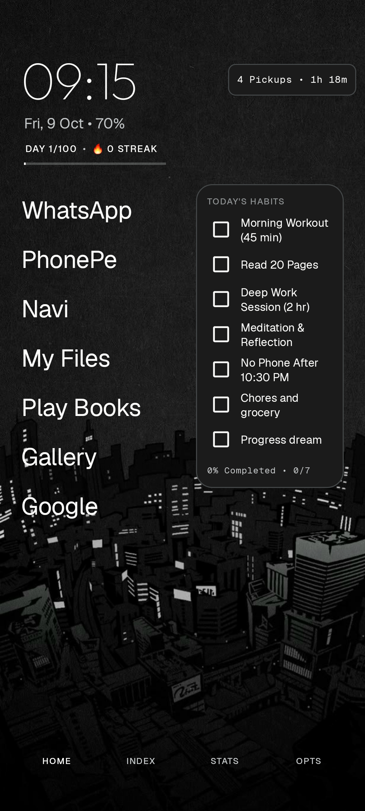
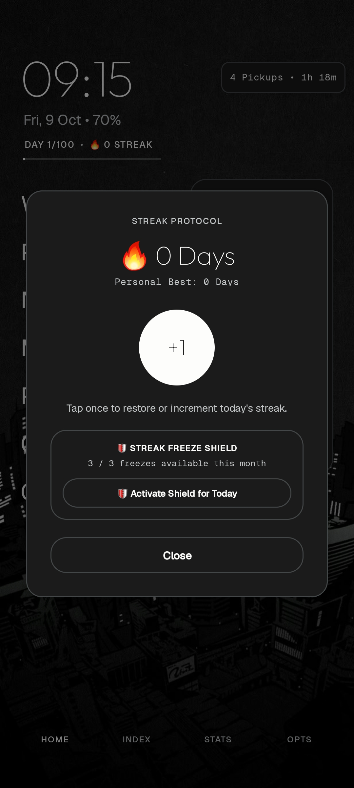
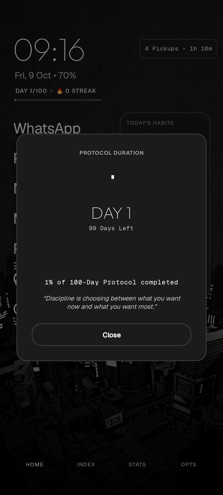
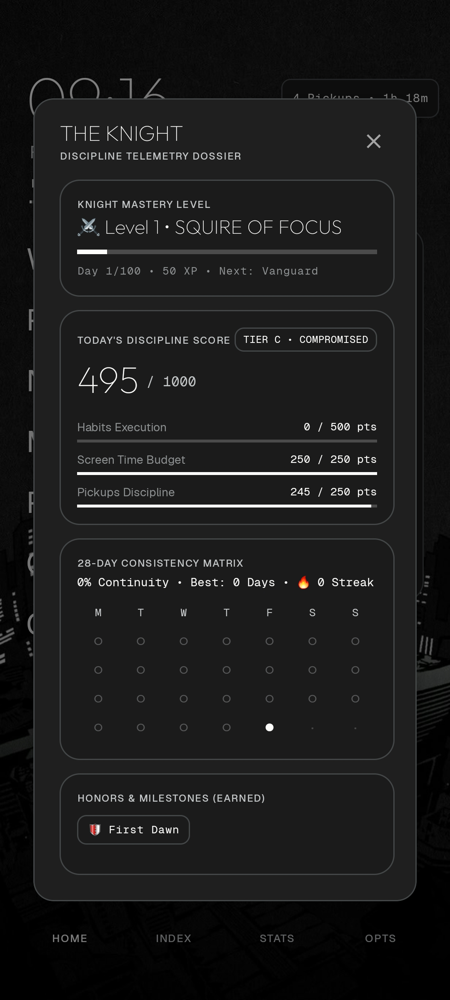
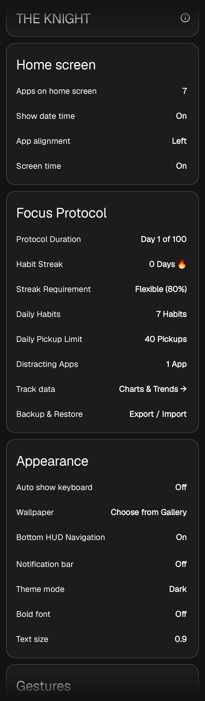
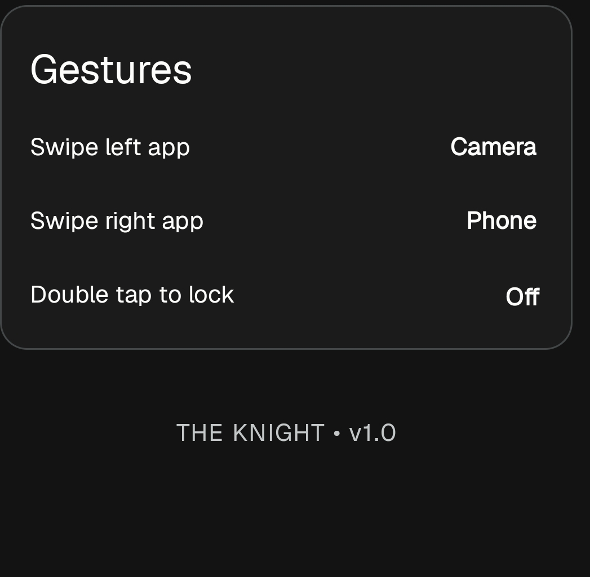

# ⚔️ THE KNIGHT • Launcher

A minimalist, high-discipline Android launcher engineered to eliminate doomscrolling, build daily consistency, and turn focus into a gamified protocol.

Based on the open-source [Olauncher](https://github.com/tanujnotes/Olauncher) by Tanuj.

---

## 📸 Interface Showcase

### 📱 Daily Focus & Habit Tracking
| 🏠 Home Screen & Habit HUD | 🔥 Streak Protocol & Shield |
| :---: | :---: |
|  |  |
| **Clean home layout** with live habit checklist, daily pickup & screen-time counter, and quick navigation HUD. | **Streak tracking** with personal best record, manual increment, and a **3×/month Streak Freeze Shield**. |

### 📊 Discipline Telemetry & Progress
| ⏳ 100-Day Protocol Duration | 🛡️ Discipline Telemetry Dossier |
| :---: | :---: |
|  |  |
| **Progress tracker** showing days remaining, percentage completed, and daily stoic focus wisdom. | **Knight Mastery System** (Level progression, 1000-pt daily score breakdown, 28-day consistency matrix & milestones). |

### ⚙️ Protocol Customization & Controls
| 🛠️ Focus Protocol Settings | 👆 Gestures & Quick Access |
| :---: | :---: |
|  |  |
| **Custom parameters** for habits, streak threshold rules, pickup limits, distracting app locks, and data backup/export. | **Fluid gestures** for swipe left/right shortcuts, double-tap lock, and streamlined UI preferences. |

---

## ✨ Key Modifications & Features

- **✅ Live Habit Tracker on Home Screen**: Check off daily habits directly from the launcher home screen with instant progress feedback.
- **🛡️ Streak Freeze Shield**: 3 manual grace passes per month so unexpected emergencies or illnesses do not erase weeks of progress.
- **📈 Knight Discipline Telemetry Dossier**: 
  - XP progression and Knight Mastery titles (*Squire of Focus* → *Vanguard* → *Paladin*).
  - Daily 1000-point discipline score calculated from habit completion, screen time budget, and pickup count.
  - 28-day dot consistency matrix and earned milestone badges.
- **⏳ 100-Day Protocol Duration**: Set custom protocol durations with countdown tracking and daily motivational quotes.
- **🚫 Anti-Doomscrolling Launch Gates**: Intentional launch delays on flagged distracting applications to break impulsive muscle memory.
- **🧭 Bottom Micro HUD**: Quick one-tap navigation to Home, Index, Stats, and Options.
- **⚡ Ultra-Lightweight & Private**: ~2.5 MB optimized release build, 100% offline, zero tracking or telemetry sent outside.

---

## 🛠️ Tech Stack & Architecture

- **Platform**: Android (Native Kotlin)
- **Min SDK**: 26 (Android 8.0+) | **Target SDK**: 35 (Android 15)
- **Architecture**: Single Activity, Android Jetpack, Coroutines & Flow
- **Storage**: SharedPreferences & encrypted local state (zero cloud dependencies)
- **Build Engine**: Gradle 8.11 with R8 code & resource shrinking (~2.5 MB Release APK)

---

## 📜 Credits & License

- Forked and modified from [Olauncher](https://github.com/tanujnotes/Olauncher) by Tanuj.
- Licensed under the [GNU General Public License v3.0](https://www.gnu.org/licenses/gpl-3.0.en.html).
